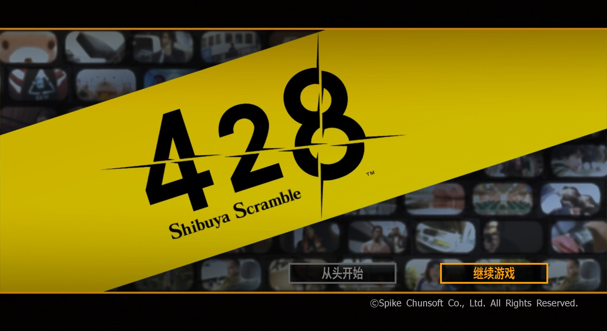
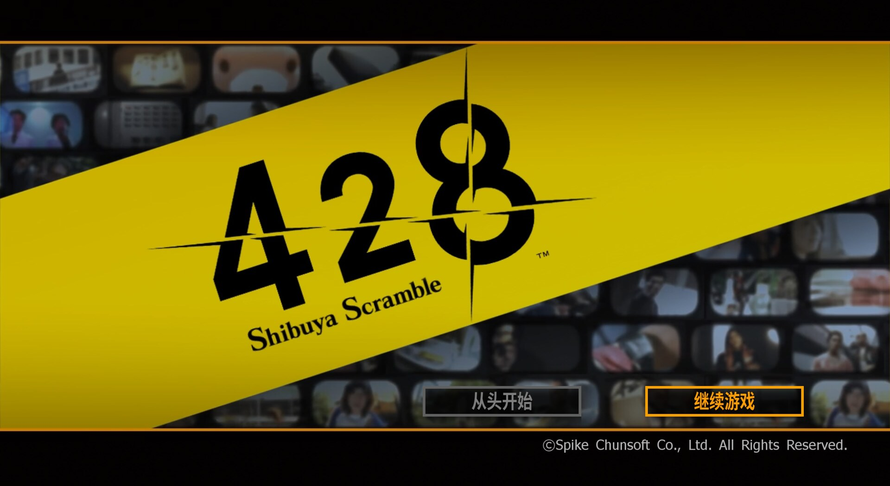
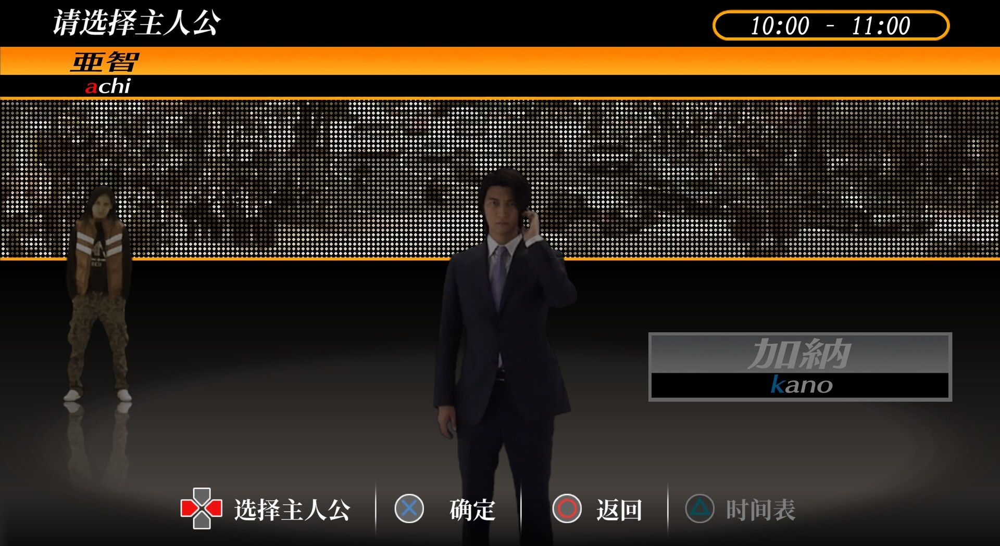
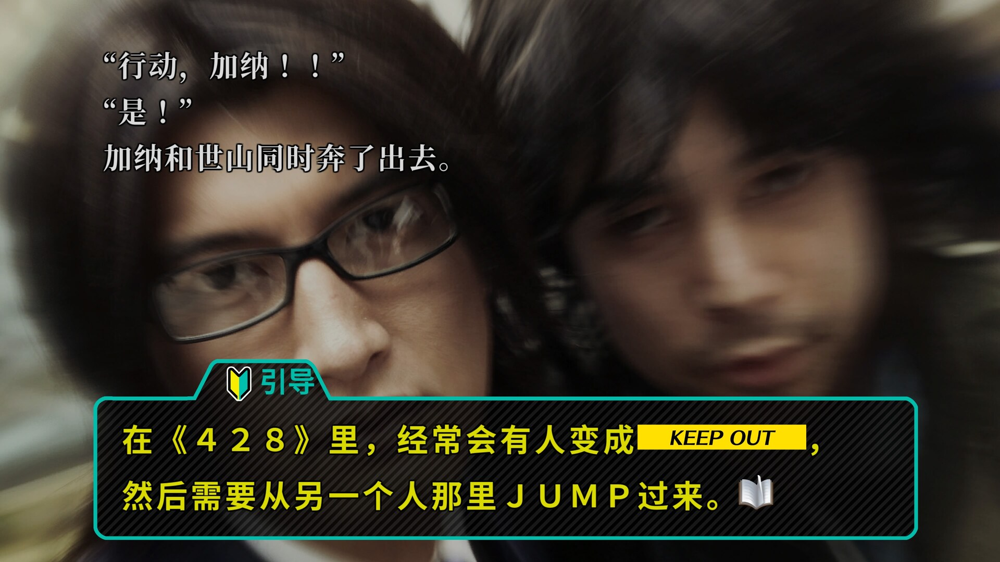

# 428 被封锁的涩谷 PS4 中文汉化补丁

《428 被封锁的涩谷》（428: Shibuya Scramble）PS4 欧版的非官方中文汉化补丁。中文文本移植自 PSP 汉化版。

下载：见 [Releases](../../releases)，文件 `428-CUSA11946-zh-patch-v0105.pkg`（815 MiB）。

## 截图

以下截图取自 PS5 实机（固件 13.60，v1.1 / v1.2 补丁）。

| 标题画面 | 剧本选择 |
|---|---|
|  |  |
| **选择主人公** | **对话与引导说明** |
|  |  |
| **选项** | |
|  | |

## 适用版本

| 项 | 要求 |
|---|---|
| 游戏 | PS4 欧版 **CUSA11946**，Content ID `EP3617-CUSA11946_00-428SHIBUYASCRAEU` |
| 本体版本 | v1.00（已经装了官方 v1.01 更新也可以，本补丁会替换它） |
| 主机 | 能安装 PS4 fPKG 的越狱主机 |

美版、日版的 Title ID 不同，不能用。

已测试环境：PS5 固件 13.60（kstuff + OnionHEN），用 ps5upload 安装。PS4 主机暂未测试。

## 安装

1. 先装好游戏本体（欧版 v1.00）。
2. 像安装游戏更新一样安装 `428-CUSA11946-zh-patch-v0105.pkg`。补丁版本号是 01.05（装过旧版的直接覆盖安装）。
3. 启动游戏。系统语言不限。

卸载：删除游戏的更新数据，或重新安装本体。

## 汉化内容

已汉化：
- 全部剧本正文
- TIP 辞典
- 菜单、引导说明、系统提示
- 按钮图标说明

未汉化：
- 图片里的文字
- 过场动画字幕
- 制作人员表
- 问答小游戏的假名键盘（有意保留）

说明：
- PS4 版比 PSP 版多出的少量句子（约 650 处，多为短句、语气词和句尾），由本补丁补译，不是 PSP 汉化组的原文。
- 大泽的「玛丽亚没救了」打乱文字的场面沿用 PSP 版做法，用打乱的中文字表现。
- TIP 辞典里解释日文读音的条目保留了假名，这是 PSP 汉化组的原样。

遇到问题请在 Issues 里反馈，最好附上截图和出现的位置（角色、时间段）。

## 技术说明

游戏在非日文模式下运行，所以本补丁做了这些改动：

- 把中文剧本写进 `shibuya_ps4_data_core.wad`，并去掉注音。
- 把中文界面写进 `shibuya_ps4_data_core_patch.wad`。
- 修改 `eboot.bin` 的排版判断，让中文按字断行。
- 界面字体换成思源黑体，正文使用游戏自带的思源宋体。

补丁只包含上面这 3 个文件，其余文件都从本体读取。

## 致谢

- 中文文本：PSP 版《428 被封锁的涩谷 V1.1 [简]》，**PLAY汉化组 & 扑家汉化组 & KIDSFC特创组**（PS4 新增部分为本补丁补译）
- 字体：思源黑体 / 思源宋体（Adobe，SIL Open Font License 1.1）
- 打包工具：[OpenOrbis/LibOrbisPkg](https://github.com/OpenOrbis/LibOrbisPkg)（LGPL-3.0）
- 安装与调试：ps5upload

详见 [NOTICE.md](NOTICE.md)。

## 声明

本补丁为爱好者制作的非官方汉化，与 Spike Chunsoft 及各发行商无关。补丁不包含游戏本体，请自备游戏。仅供学习交流，请勿用于商业用途。
